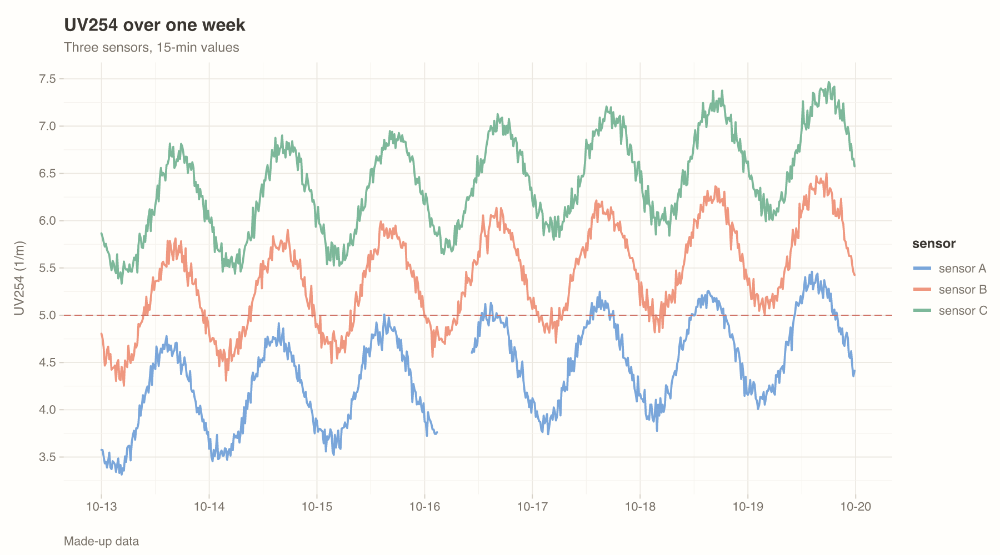
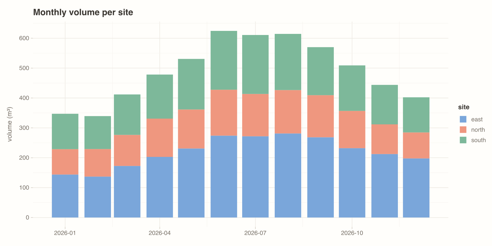
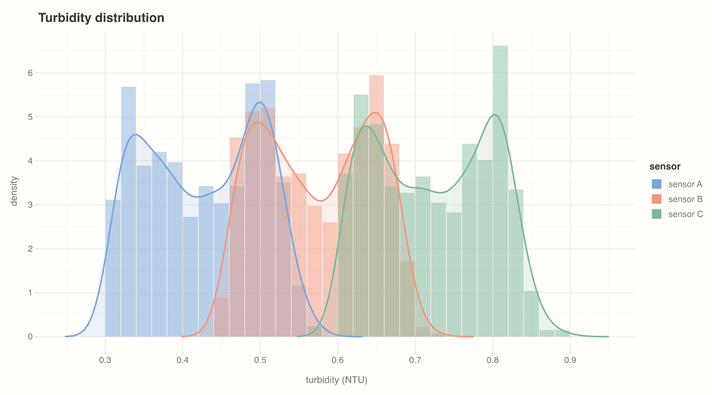
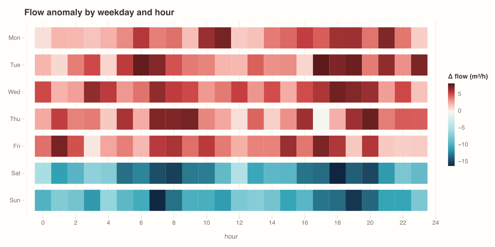
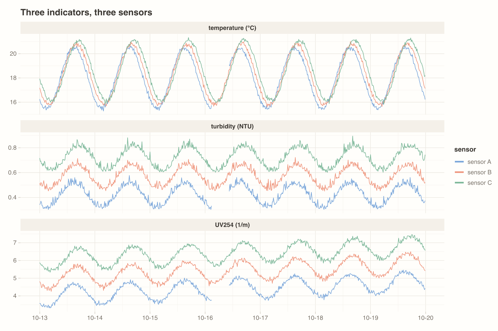
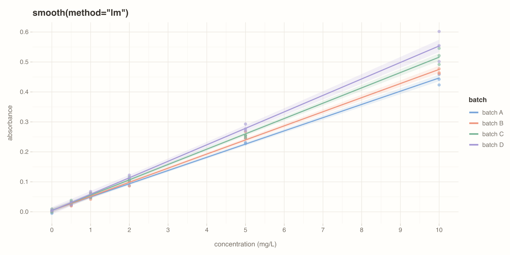

# plotto

plotto makes grammar-of-graphics plots for notebooks, web pages, slides and reports. You write a plot in Python or in JavaScript with the same methods. One renderer draws it, so the notebook view, the interactive view and the saved file look the same.

**Gallery:** [gallery link](https://theoradusz.github.io/plotto/), with pages for the basics, the plot types, the colors, the scales and legends, a step-by-step grammar tutorial and the API reference. `SPEC.md` is the contract: the spec format, the rules, the layers, the scales and the behavior.

<p>
 
 
 
</p>

```python
from plotto import plot

p = (
    plot(df, x="time", y="value", color="sensor")
    .line()
    .hline(y=0.75, color="red", dash="dashed")
    .facet("indicator", free="y")
    .y(limits=[0, None])
    .labels(title="Water quality", x=None)
)
p                                   # drawn at the cell width, with copy and download buttons
p.interactive()                     # the same plot with zoom, pan, hover and legend toggle
p.theme("wota")                     # another style
p.color(palette="aizome")           # another palette
p.save("fig.png")                   # PNG; .svg for vector files
p.theme("wota", format="slide").save("slide.png")   # 691 × 403 px: 7.2 × 4.2 in on a slide
```

```js
import { plot, draw } from "plotto";
draw(plot(rows, { x: "time", y: "value", color: "sensor" }).line().facet("indicator", { free: "y" }), el, { interactive: true });
```

## How it works

1. The builder writes a JSON spec: the data columns, the layers, the scales, the facets, the labels and the theme.
2. `src/figure.js` computes the statistics, the scales and the layout. Then it draws the title, strips and legend, and Observable Plot draws each panel.
3. In the browser, a zoom, a legend click or a resize draws the figure again with the same code. The look does not change.
4. For files, Python sends the spec to one Node process (`src/render.mjs`). The process draws the SVG with jsdom and the PNG with resvg.

| Part | Files |
|---|---|
| Grammar and themes | `grammar.json` (layers, channels, options), `theme.json` (styles, formats) |
| JS builder and renderer | `src/`. Each file has one job, stated in its header comment. |
| Python builder and outputs | `python/plotto/` |
| Examples | `examples/` |
| Tests | `tests/`, `python/tests/` |

## Install

| Where | Install | Import |
|---|---|---|
| Python, notebooks | `pip install python-plotto` | `from plotto import plot` |
| Web pages, React | `npm install plotto` | `import { plot, draw } from "plotto"`; `import { Plot } from "plotto/react"` |

- Python 3.12 or later. A notebook plot needs no Node.
- `save()` (PNG and SVG files) and the static copy in notebook outputs need Node.js 20 or later. On the first use, plotto downloads its renderer with `npx` (the npm package of the same version) and keeps it in the npm cache.
- The `wota` style uses the M PLUS 1p font. Install the font to use that style.

### Development

1. Clone the repo and run `npm install`.
2. Run `pip install -e "python[test]"` in a virtual environment. In a checkout, the package uses `grammar.json`, `theme.json` and `src/` of the repo directly.

## Use

### Data

- Use long format: one row per observation, one column per variable.
- Python takes a pandas DataFrame or a list of dicts. JavaScript takes an array of row objects.
- A time-zone-aware datetime column shows its local clock time.
- To set the order of categories, use a pandas categorical column or `x(limits=[...])`.

### Axes and colors

| Need | Call |
|---|---|
| Axis range | `x(limits=[0, 10])`; `y(limits=[0, None])` keeps the data bound on the `None` side |
| Category order | `x(limits=["low", "mid", "high"])` |
| Log axis, time labels | `y(type="log")`; `x(format="%a %H:%M")` |
| Category colors | `color(palette="sakura")`, or `color(values={"a": "red", "b": "#123456"})` |
| Number colors | `color(scheme="ai")`; diverging: `color(scheme="aiaka", mid=0)` |

Palettes: `pastel` (the default style), `sakura`, `aizome`, `momiji` (inspired by traditional Japanese colors), `wota`, `tableau`. Schemes: `ai`, `sakura`, `matcha`, `yuhi`, `sumi`, `aiaka` (diverging), and every d3 scheme (`viridis`, `magma`, …).

### Info table

Put facts about the data or the experiment in a table instead of a long subtitle:

```python
p.info({"data point": 15, "location": "hayama", "experiment": "cleaning with chlorine"})
p.info(entries, position="bottom")   # "right" (default) or "bottom"
```

The table is a card on the right of the plot, or below it. A plot narrower than 560 px puts it below. `SPEC.md` §7 has the rules.

### Notebook

- A plot shows at the width of the cell. The text keeps its size, and the height follows the aspect ratio of the format.
- `.interactive()` adds zoom, pan, hover and the legend toggle.
- The hover follows the plot type:
  - lines and areas: every series at the nearest x, or only the series under the pointer when there are more than 6;
  - bars: the stack and its total;
  - box: the quartiles;
  - tile: the cell value;
  - points: the nearest point.
- A click pins the hover label; the next click (or Esc) releases it. A drag starts after 5 px of movement; a double-click resets the view.
- A legend click hides or shows a series. Two quick clicks on the same entry (within 300 ms) show only that series.
- The toolbar shows at the top right when the pointer is on the plot:
  - copy as PNG;
  - copy for a slide: the current view in the slide format, which pastes into Google Slides at 7.2 × 4.2 in, sharp;
  - download as PNG or SVG;
  - in interactive mode, also zoom box, pan, zoom in, zoom out and reset.
- The output loads d3 and Observable Plot from `cdn.jsdelivr.net`. GitHub, nbviewer, or a page without network access shows the static SVG in the output.
- Each output holds the data of the plot and the plotto script (about 60 kB). A plot with 20 000 points adds about 2 MB to the notebook.

### Web pages and React

- `draw(spec, element, { interactive })` draws into an element at its width, and draws again when the width changes. It returns `{ destroy }`.
- In React, use `import { Plot } from "plotto/react"`, then `<Plot spec={plot(rows, {...}).line()} interactive />`.

### Slides and reports

| Target | Use |
|---|---|
| Google Slides | The "Copy for a slide" button, then paste under the slide title: 7.2 × 4.2 in, with room for comments on the right. Or a PNG: `p.save("fig.png")`. Google Slides does not accept SVG. |
| PowerPoint, Keynote, documents | SVG: `p.save("fig.svg")`. The SVG uses the installed fonts. |
| A slide layout | `p.theme(style, format="slide")`: 691 × 403 px, the size on the slide |
| A report column | `p.theme(style, format="report")`: 640 × 400 px |
| Square panels | `p.theme(aspect=1)`, for observed-against-predicted plots. Give x and y the same `limits`. |
| A given size | `p.save("fig.png", width=1600)` lays the plot out again at 1600 px. |
| From the notebook | Use the copy button, which copies the current view as PNG. |

## Examples

| File | Content |
|---|---|
| `examples/gallery.py` | 28 examples on 4 pages (basics, plot types, colors, scales and legends), which use every feature. The data is made-up, except for two files of real measurements. |
| `examples/grammar.py` | The grammar tutorial: 14 steps, each with its text, code and result. |
| `examples/reference.py` | The API reference. The layer methods come from `grammar.json`. |
| `examples/build_site.py` | Builds the site in `docs/`: one HTML page per gallery page, `grammar.html` and `reference.html` (each with the plotto script inline), and `img/` (the PNG and SVG of each gallery plot). GitHub Pages serves `docs/`. |
| `examples/showcase.ipynb` | The examples in a notebook. |
| `examples/web/` | Examples in JavaScript. Run `python3 -m http.server` in the repo, then open `http://localhost:8000/examples/web/`. |

To publish the gallery:

1. Run `python examples/build_site.py`.
2. Commit `docs/`.
3. On GitHub, set Settings → Pages → Source to "Deploy from a branch", with branch `main` and folder `/docs`.
| `examples/data/` | The datasets. `examples/make_datasets.py` makes the made-up ones. |

## Tests

| Command | What it verifies |
|---|---|
| `npm test` | Each layer and style (SVG snapshots in `tests/snapshots/`), stacks, bins, smooth fits, domains, facets, legends, reflow, errors |
| `npm run browser-test` | In headless Chrome: the browser SVG equals the Node SVG. Zoom, Home, the toolbar, hover, legend clicks and their timing, reflow and the static mode work. |
| `pytest python/tests` | The Python and JS builders make the same spec; data conversion; SVG and PNG files; notebook output |
| `ruff check . && black --check .` | Python lint |

If a change of the look is intentional, run `UPDATE_SNAPSHOTS=1 npm test` and review the SVG diff.

## Maintenance

To add a layer type:

1. Add the layer to `grammar.json`: channels, options and required channels.
2. Add one entry to `LAYERS` in `src/layers.js`.
3. For a statistic, add the computation to `src/stats.js` and a case to `makeView` and `hoverOf` in `src/views.js`.
4. Add the method to `src/builder.js` and `python/plotto/plot.py`.
5. Add a case to `tests/render.test.js` and to `tests/fixtures/parity.json`.
6. Add a row to the layer table in `SPEC.md`.

To change a style, a format, a palette or a scheme, edit `theme.json`. A scheme is a list of colors from light to dark; plotto interpolates it in Lab space. To use a new font, add it to `scripts/font_metrics.py`, run the script, and set `font` and `metrics` of the style.

## Release

A tag `vX.Y.Z` publishes `python-plotto` to PyPI and `plotto` to npm (`.github/workflows/release.yml`).

One-time setup:

1. On pypi.org, create an account. Under "Publishing", add a pending trusted publisher: project `python-plotto`, owner `theoradusz`, repository `plotto`, workflow `release.yml`, environment `pypi`.
2. On GitHub, create the environment `pypi` (Settings → Environments).
3. On npmjs.com, create an account (with two-factor authentication). Publish the first version from your computer, in the repo:

   ```
   npm login
   npm test
   npm publish --access public
   ```

4. On npmjs.com, open the package `plotto` → Settings → Trusted publishing → GitHub Actions: repository `theoradusz/plotto`, workflow `release.yml`. Later versions then publish from GitHub with no token. The workflow skips a version that is already on npm.

Each release (`main` takes changes only through a reviewed pull request):

```bash
# 1. Merge your changes into main through a pull request,
#    with a line for each change under "## Unreleased" in CHANGELOG.md

# 2. Prepare the release
git switch main && git pull && source .venv/bin/activate
scripts/release.sh 0.3.1
#    → the pull request page opens: create it, get it approved and merged

# 3. Publish
scripts/release.sh tag    # answer y

# 4. Check
npm view plotto version && pip index versions python-plotto
```

- `scripts/release.sh X.Y.Z` checks that `main` is current, that the version is new and that `CHANGELOG.md` has changes under "Unreleased". It runs every test and lint. Then, on the branch `release/vX.Y.Z`, it sets the version in `package.json`, `package-lock.json` and `python/plotto/__init__.py`, moves the "Unreleased" changes to a dated `X.Y.Z` section, builds `docs/`, commits and pushes.
- `scripts/release.sh tag` tags the merged `main` as `vX.Y.Z`, asks before it pushes the tag, and deletes the release branch.
- The pushed tag runs `.github/workflows/release.yml`, which publishes to PyPI and npm. Follow it in the Actions tab.

To upgrade Observable Plot or d3:

1. Change the exact version in `package.json`.
2. Run `npm install`.
3. Run the tests. A snapshot difference shows a change of the look.
